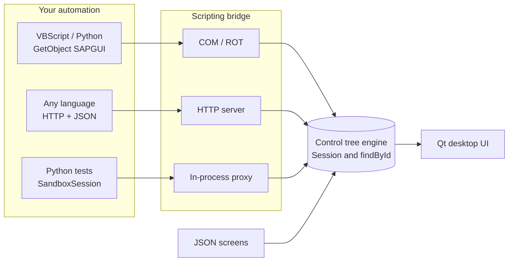

<div align="center">

# GUI Sandbox

### Build and test SAP GUI automation without an SAP system.

A local Windows app that simulates the SAP GUI Scripting object model.<br>
Connect with `GetObject("SAPGUI")`, explore real-looking screens, and develop your scripts on your own PC.

[](LICENSE)
[](#quick-start)
[](#quick-start)
[](#by-the-numbers)


**[▶ Watch the 30-second film](docs/assets/film/gui-sandbox-demo.mp4)**

</div>

> **Independent project.** GUI Sandbox is not affiliated with, endorsed by, or sponsored by SAP SE. See [NOTICE](NOTICE).

## Why GUI Sandbox?

SAP GUI automation is hard to develop when every experiment needs a live system, credentials, and the right authorisations. GUI Sandbox gives you a safe place to write and try the script first.

| | Live SAP system | GUI Sandbox |
|---|---|---|
| **Access** | Account and authorisations required | Runs locally, no login |
| **SAP software** | SAP GUI installation required | None required |
| **Data** | Real business data at risk | Fictional sample data only |
| **Mistakes** | Can change real records | Nothing to break, restart to reset |
| **Network** | Connection to the system required | Works offline |
| **Cost to try** | Licensed landscape | Free and open source |

GUI Sandbox is for development, training, and testing. It simulates the scripting surface and doesn't run SAP business logic, so test your finished automation on a real system before relying on it.

## What you get

- 🔌 **Three ways to connect:** COM through `GetObject("SAPGUI")`, a local HTTP JSON API, or in-process Python.
- 🧩 **A familiar object model:** `findById`, `Children`, `Info`, `sendVKey`, and 30 control types with the `Gui*` type names scripts expect.
- 🖥️ **A real desktop UI:** menus, toolbars, tabs, grids, and tables, all rendered from the same control tree your script reads.
- 📼 **An action recorder:** timestamped logs of `findById`, `setText`, `press`, and `sendVKey` for checking what a script did.
- 🧪 **15 ready-made screens:** a logon screen, Data Browser, ABAP Editor, job overview, users, sales orders, and materials.
- ✏️ **Easy to extend:** screens are plain JSON, generated from one readable Python script.

## Take a look

<table>
  <tr>
    <td width="50%"><br><b>Home</b>: open any transaction from the menu or command field</td>
    <td width="50%"><br><b>SE16 selection</b>: range filters on a sample table</td>
  </tr>
  <tr>
    <td><br><b>SE38</b>: the ABAP Editor with a sample report</td>
    <td><br><b>SM37</b>: job selection with status filters</td>
  </tr>
  <tr>
    <td><br><b>VA03</b>: tabs and table controls in a sales order</td>
    <td><br><b>SE16 results</b>: a grid your scripts can read</td>
  </tr>
</table>

## How it works

One control tree is the source of truth. The UI renders it, and every bridge reads and writes the same session.



## Quick start

```bash
git clone https://github.com/Ghaith-Automation-Consultant/GUI_Sandbox.git
cd GUI_Sandbox
pip install -r requirements.txt
python main.py
```

Close SAP Logon first, because both register under the same `SAPGUI` name. When you see `COM bridge started` in the terminal, the sandbox is ready.

The app opens on a logon screen. Log on with client `000`, user `USER_STANDARD` and password `sandbox`. These test credentials are defined in [`engine/logon.py`](engine/logon.py); never put credentials for a real system there. To skip the logon screen, run `python main.py --no-logon`. Type `/nend` in the command field to log off.

### Connect over COM

Log on from your script with the same field IDs as the SAP GUI logon screen:

```python
import win32com.client

sap = win32com.client.GetObject("SAPGUI")
session = sap.GetScriptingEngine.Children(0).Children(0)

session.findById("wnd[0]/usr/txtRSYST-MANDT").Text = "000"
session.findById("wnd[0]/usr/txtRSYST-BNAME").Text = "USER_STANDARD"
session.findById("wnd[0]/usr/pwdRSYST-BCODE").Text = "sandbox"
session.findById("wnd[0]/usr/txtRSYST-LANGU").Text = "EN"
session.findById("wnd[0]").sendVKey(0)

print(session.Info.User)  # USER_STANDARD
```

Then type `SE16` in the app's command field and press Enter, and run:

```python
print(session.Info.Transaction)  # SE16

field = session.findById("wnd[0]/usr/ctxtDATABROWSE-TABLENAME")
field.Text = "SFLIGHT"
print(field.Text)  # SFLIGHT
```

<details>
<summary><b>Read a grid over HTTP</b></summary>

```python
from bridge import RemoteSession, start_server
from engine import load_screen

server = start_server(load_screen("screens/04_SE16_SFLIGHT_results.json"), port=7654)
session = RemoteSession(server.url)

grid = session.findById("wnd[0]/usr/cntlGRID1/shellcont/shell")
print(grid.RowCount)                  # 8
print(grid.GetCellValue(0, "CARRID"))  # SX

server.shutdown()
```

</details>

<details>
<summary><b>Test in-process and inspect the recording</b></summary>

```python
from bridge import SandboxSession
from engine import load_screen

session = SandboxSession(load_screen("screens/02_SE16_initial.json"))
session.findById("wnd[0]/usr/ctxtDATABROWSE-TABLENAME").Text = "SFLIGHT"
session.findById("wnd[0]").sendVKey(0)

for entry in session.recorder.entries():
    print(entry["action"], entry.get("path", ""), entry.get("value", ""))
```

</details>

## Included transactions

| Transaction | What it shows | Steps in the flow |
|---|---|---|
| `S000` | Logon screen: client, user, password, language | 1 |
| `SE16` | Data Browser: table name, selection, results grid | 3 |
| `SE16N` | General table display with a selection table | 2 |
| `SE38` | ABAP Editor: start screen, source, attributes | 3 |
| `SM37` | Job selection | 1 |
| `SU01` | User maintenance | 1 |
| `VA03` | Sales order with tabs and an item table | 2 |
| `MM03` | Material display | 1 |

All screens use fictional data. To add your own, extend [`tools/generate_screens.py`](tools/generate_screens.py) and rerun it.

## By the numbers

<table>
  <tr>
    <td align="center"><h3>3</h3>scripting bridges</td>
    <td align="center"><h3>30</h3>control types</td>
    <td align="center"><h3>15</h3>sample screens</td>
    <td align="center"><h3>232</h3>automated tests</td>
  </tr>
</table>

<p align="center">
  
</p>
<p align="center">
  
</p>

## Status and roadmap

**Works today**

- [x] Qt interface with navigation between all included transactions
- [x] COM, HTTP, and in-process bridges reading and writing the active session
- [x] Action recording
- [x] Generated sample screens with automated guards against live-system data

**Coming next**

- [ ] Transaction navigation started by scripts: `StartTransaction` and the command field don't load a new screen yet, so open transactions in the UI for now
- [ ] Keyboard focus engine
- [ ] Modal popups (`wnd[1]`, `wnd[2]`)
- [ ] Functional status bar messages

## Documentation

| Document | Description |
|---|---|
| [Architecture](docs/architecture.md) | Layer-by-layer design |
| [API Reference](docs/api_reference.md) | COM, HTTP, and Python APIs |
| [User Guide](docs/user_guide.md) | Installation and usage (French) |
| [Technical Documentation](docs/DOCUMENTATION_TECHNIQUE.md) | Data model and COM bridge (French) |

## Adding screens

The sample screens are defined in [`tools/generate_screens.py`](tools/generate_screens.py). `tools/sap_inspect.py` can also capture screens from a SAP system you are authorised to access. Captures contain system identifiers, usernames, hostnames, and business data, so **never commit a capture or a screenshot of a live system**. `tests/test_screens_sanitized.py` checks for placeholder identities, email addresses, IP addresses, and non-English text, but it can't detect every kind of sensitive value.

## License

Licensed under the [Apache License, Version 2.0](LICENSE). See [NOTICE](NOTICE) for attributions and trademark details.
