<div align="center">

# GUI Sandbox

### Build and test SAP GUI automation without an SAP system.

A local Windows app that simulates the SAP GUI Scripting object model.<br>
Connect with `GetObject("SAPGUI")`, drive real-looking screens from your script, and develop on your own PC.

[](LICENSE)
[](#quick-start)
[](#quick-start)
[](#by-the-numbers)

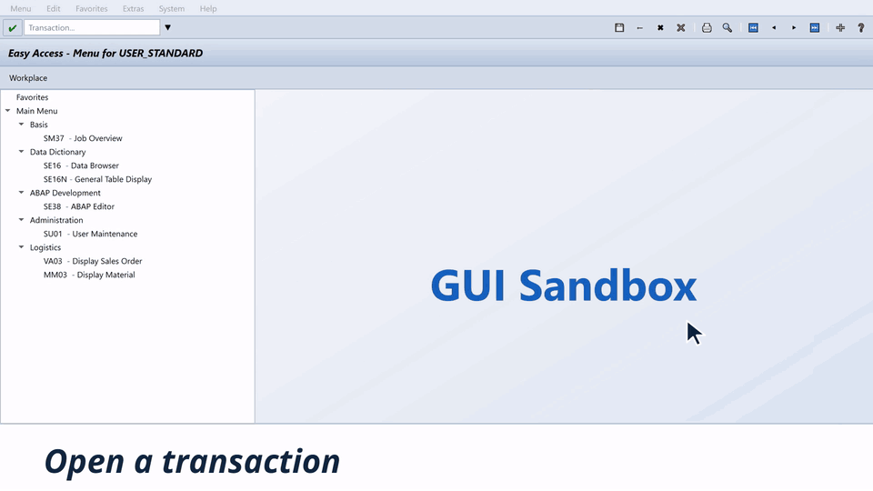

**[▶ Watch the 30-second film](docs/assets/film/gui-sandbox-demo.mp4)**

</div>

> **Independent project.** GUI Sandbox is not affiliated with, endorsed by, or sponsored by SAP SE. See [NOTICE](NOTICE).

## Why GUI Sandbox?

SAP GUI automation is hard to develop when every experiment needs a live system, credentials, and the right authorisations. GUI Sandbox gives you a safe place to write and try the script first.

| | Live SAP system | GUI Sandbox |
|---|---|---|
| **Access** | Account and authorisations required | Runs locally, with test users or no logon at all |
| **SAP software** | SAP GUI installation required | None required |
| **Data** | Real business data at risk | Fictional sample data only |
| **Mistakes** | Can change real records | Nothing to break, restart to reset |
| **Network** | Connection to the system required | Works offline |
| **Cost to try** | Licensed landscape | Free and open source |

GUI Sandbox is for development, training, and testing. It simulates the scripting surface and doesn't run SAP business logic, so test your finished automation on a real system before relying on it.

## What you get

- 🔌 **Three ways to connect:** COM through `GetObject("SAPGUI")`, a local HTTP JSON API, or in-process Python.
- 🖧 **An SAP Logon window:** pick an environment, or open one from a script with `OpenConnection("WL - With logon", True)`, as on a real landscape.
- 🔑 **Logon and password popups:** per-environment test users, forced password changes, SU3 and SU01 resets in `wnd[1]`/`wnd[2]` popups, checked against the open-source [PySapGUI](https://github.com/gutskodv/PySapGUI) library.
- 📜 **Tables that scroll like the real ones:** a table control only has cells for the rows on screen, `VerticalScrollbar.Position` pages through it, and references go stale after each scroll. ALV grids load rows as they scroll, with `FirstVisibleRow`, `SetCurrentCell`, and `SelectedRows`.
- 🧭 **Scripts that navigate:** `StartTransaction`, the command field, and virtual keys move through each flow, and the window follows along.
- 🧩 **A familiar object model:** `findById`, `Children`, `Info`, `sendVKey`, and 30 control types with the `Gui*` type names scripts expect.
- 🖥️ **A real desktop UI:** menus, toolbars, tabs, grids, and tables, all rendered from the same control tree your script reads.
- 📼 **An action recorder:** timestamped logs of `findById`, `setText`, `press`, and `sendVKey` for checking what a script did.
- 🧪 **16 ready-made screens:** a logon screen, Data Browser, ABAP Editor, job overview, users, user profile, sales orders, and materials.
- ✏️ **Easy to extend:** screens are plain JSON, generated from one readable Python script.

## Take a look

<table>
  <tr>
    <td width="50%">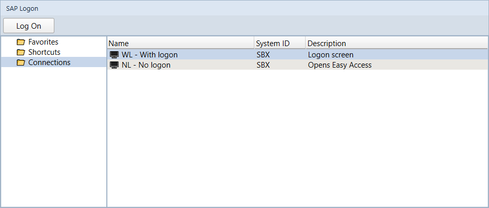<br><b>SAP Logon</b>: choose an environment, or open it with <code>OpenConnection</code></td>
    <td width="50%">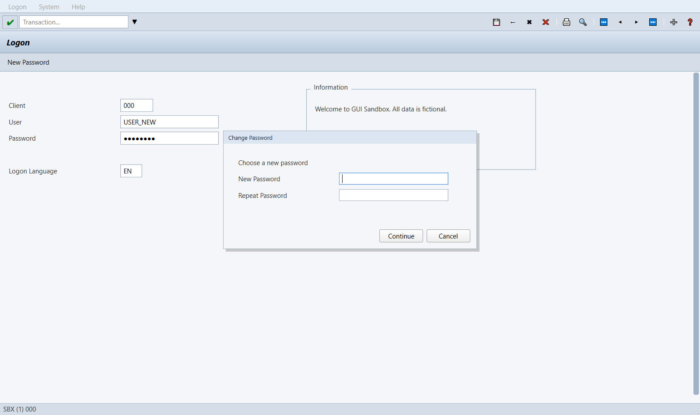<br><b>Password popup</b>: a forced change at logon, in <code>wnd[1]</code></td>
  </tr>
  <tr>
    <td width="50%">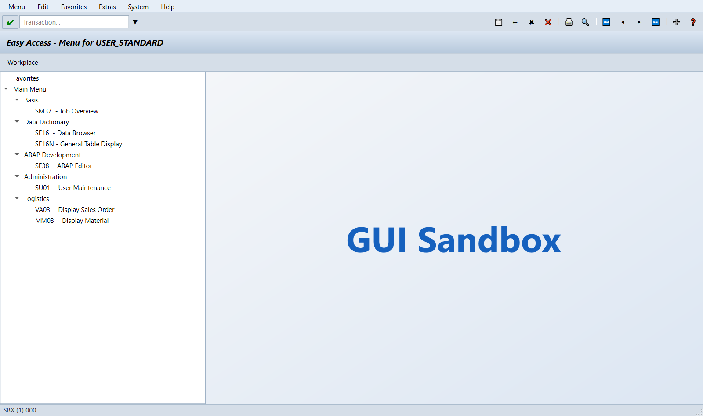<br><b>Home</b>: open any transaction from the menu or command field</td>
    <td width="50%">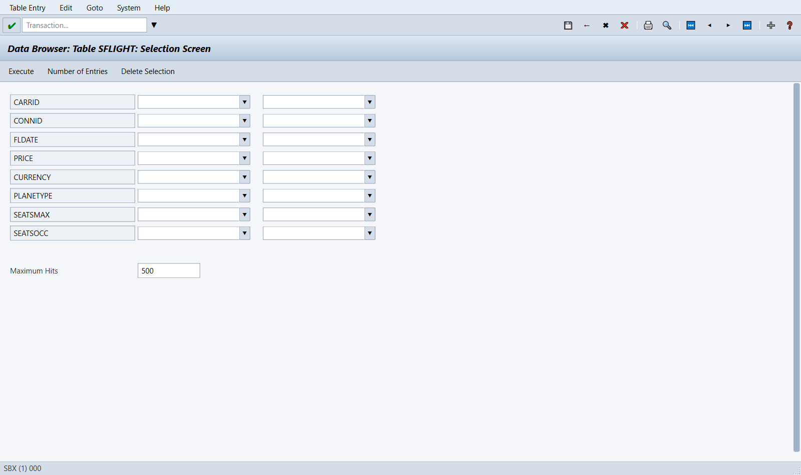<br><b>SE16 selection</b>: range filters on a sample table</td>
  </tr>
  <tr>
    <td>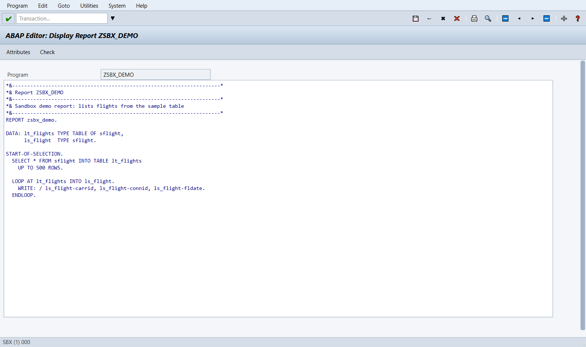<br><b>SE38</b>: the ABAP Editor with a sample report</td>
    <td>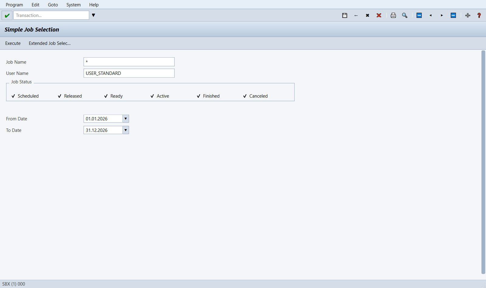<br><b>SM37</b>: job selection with status filters</td>
  </tr>
  <tr>
    <td>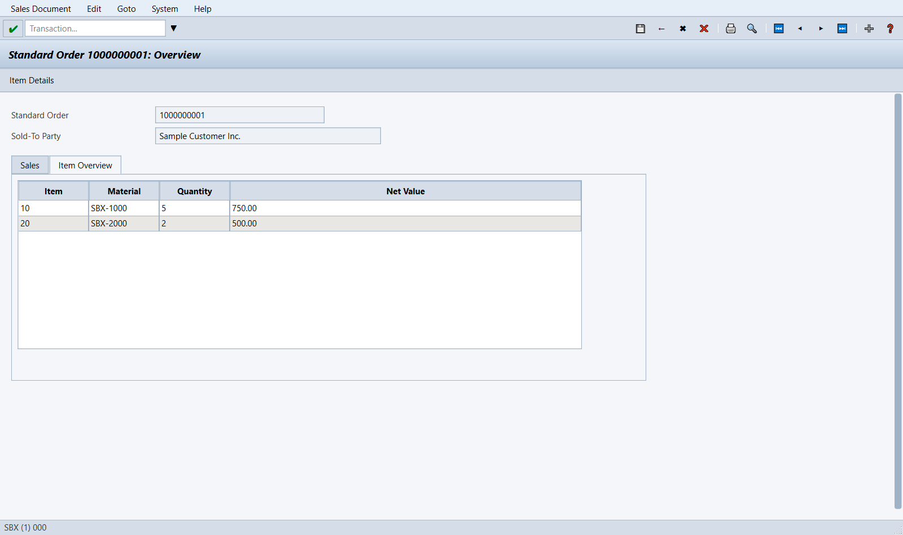<br><b>VA03</b>: tabs and table controls in a sales order</td>
    <td>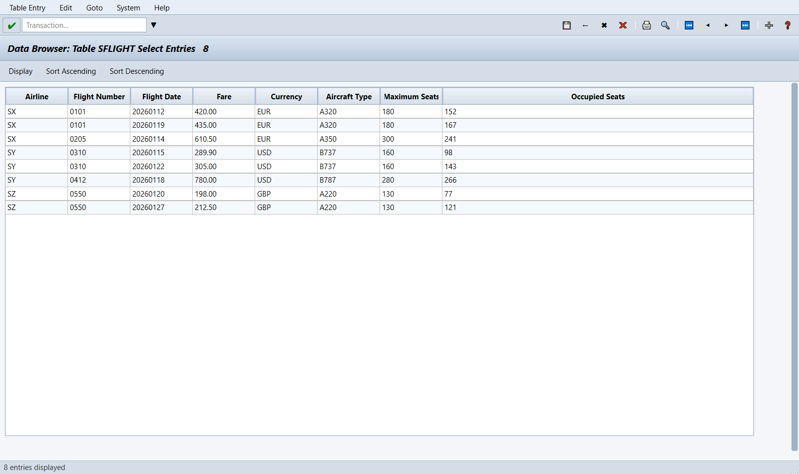<br><b>SE16 results</b>: a grid your scripts can read</td>
  </tr>
</table>

## How it works

One control tree is the source of truth. The UI renders it, and every bridge reads and writes the same session.

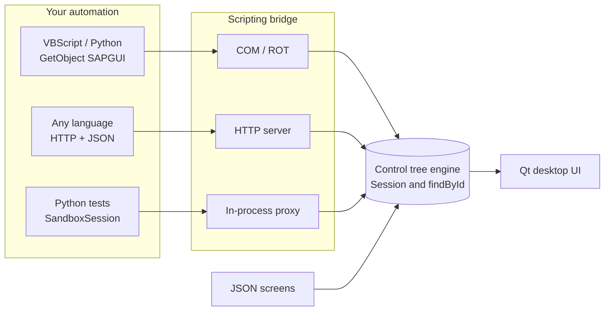

## Quick start

```bash
git clone https://github.com/Ghaith-Automation-Consultant/GUI_Sandbox.git
cd GUI_Sandbox
pip install -r requirements.txt
python main.py
```

Close SAP Logon first, because both register under the same `SAPGUI` name. When you see `COM bridge started` in the terminal, the sandbox is ready.

The app opens on an **SAP Logon** window listing the environments in [`environments.json`](environments.json). Double-click one to open it:

| Environment | Opens on |
|---|---|
| `WL - With logon` | The logon screen. Log on with client `000`, user `USER_STANDARD` and password `sandbox`. |
| `NL - No logon` | Easy Access, already logged on. |

Each environment has its own test users in [`users.json`](users.json); never put credentials for a real system there. Closing the session window returns to SAP Logon. To skip SAP Logon, run `python main.py --env WL` or `python main.py --env NL`. Type `/nend` in the command field to log off.

### Passwords and popups

Password changes open SAP-style popups (`wnd[1]`), and a rejected password opens a second one (`wnd[2]`):

| Workflow | How | Popup fields |
|---|---|---|
| Set | Logon screen, **New Password** (`tbar[1]/btn[5]`, F5) | `wnd[1]/usr/pwdRSYST-NCODE`, `pwdRSYST-NCOD2` |
| Forced | Log on as a user with an initial password, such as `USER_NEW` / `welcome1` | Same as Set |
| Change own | `SU3`, **Change Password** (`tbar[1]/btn[6]`) | `wnd[1]/usr/subSUBSCREEN:SAPMSYST:0043/pwdRSYST-BCODE`, `NCODE`, `NCOD2` |
| Reset | `SU01`, enter a user, **Change Password** (`tbar[1]/btn[20]`, Shift+F8) | `wnd[1]/usr/pwdRSYST-NCODE`, `pwdRSYST-NCOD2` |

A reset sets an initial password, so that user must choose a new one at the next logon. New passwords must be 8 to 40 characters, match, and differ from the old one. Changes last until the app restarts; `users.json` is never written. These IDs are the ones [PySapGUI](https://github.com/gutskodv/PySapGUI)'s password helpers use, and `tests/test_pysapgui.py` runs that library against the sandbox.

### Scroll tables and grids

A script that reads every row of a short table in development often fails on real data, where the rows don't fit on screen. The sandbox behaves like SAP GUI, so that failure shows up here first:

- **Table controls** (`GuiTableControl`, such as the VA03 items: 25 rows, 9 on screen) only have cells for the visible rows, with IDs like `txtVBAP-POSNR[0,3]` (`[column,row]`, counted from the top of the screen). `GetCell` on a row below the screen raises an error. Setting `VerticalScrollbar.Position` is a round trip: the table, its cells and its scrollbar from before stop working, so find the table again after each scroll.
- **ALV grids** (`GuiGridView`, such as the SE16 results: 120 flights, 24 on screen) load rows as they scroll. `GetCellValue` on a row that was never on screen returns an empty string, until `FirstVisibleRow` or `SetCurrentCell` brings it into view.

```python
table_id = "wnd[0]/usr/tabsTAXI_TABSTRIP/tabpT02/tblITEMS"
table = session.findById(table_id)
total, page = table.RowCount, table.VisibleRowCount
for first in range(0, total, page):
    table.VerticalScrollbar.Position = first
    table = session.findById(table_id)        # find it again after the scroll
    for row in range(min(page, total - first)):
        print(table.GetCell(row, 0).Text)      # 10, 20, ... 250
```

### Connect over COM

With the app running, run this from another terminal and watch the window follow your script. As with SAP Logon, it opens a connection by its description, logs on with the same field IDs as the SAP GUI logon screen, then opens a table:

```python
import win32com.client

application = win32com.client.GetObject("SAPGUI").GetScriptingEngine
connection = application.OpenConnection("WL - With logon", True)
session = connection.Children(0)

session.findById("wnd[0]/usr/txtRSYST-MANDT").Text = "000"
session.findById("wnd[0]/usr/txtRSYST-BNAME").Text = "USER_STANDARD"
session.findById("wnd[0]/usr/pwdRSYST-BCODE").Text = "sandbox"
session.findById("wnd[0]/usr/txtRSYST-LANGU").Text = "EN"
session.findById("wnd[0]").sendVKey(0)
print(session.Info.User)  # USER_STANDARD

session.StartTransaction("SE16")
session.findById("wnd[0]/usr/ctxtDATABROWSE-TABLENAME").Text = "SFLIGHT"
session.findById("wnd[0]").sendVKey(7)  # Table Contents
session.findById("wnd[0]").sendVKey(8)  # Execute

grid = session.findById("wnd[0]/usr/cntlGRID1/shellcont/shell")
print(grid.RowCount)                   # 120
print(grid.GetCellValue(0, "CARRID"))  # SX
```

<details>
<summary><b>Read a grid over HTTP</b></summary>

```python
from bridge import RemoteSession, start_server
from engine import load_screen

server = start_server(load_screen("screens/04_SE16_SFLIGHT_results.json"), port=7654)
session = RemoteSession(server.url)

grid = session.findById("wnd[0]/usr/cntlGRID1/shellcont/shell")
print(grid.RowCount)                  # 120
print(grid.GetCellValue(0, "CARRID"))  # SX

server.shutdown()
```

</details>

<details>
<summary><b>Test in-process and inspect the recording</b></summary>

```python
from bridge import SandboxSession
from engine import load_screen

session = SandboxSession(load_screen("screens/02_SE16_initial.json"))
session.findById("wnd[0]/usr/ctxtDATABROWSE-TABLENAME").Text = "SFLIGHT"
session.findById("wnd[0]").sendVKey(0)

for entry in session.recorder.entries():
    print(entry["action"], entry.get("path", ""), entry.get("value", ""))
```

</details>

## Included transactions

| Transaction | What it shows | Steps in the flow |
|---|---|---|
| `S000` | Logon screen: client, user, password, language | 1 |
| `SE16` | Data Browser: table name, selection, results grid | 3 |
| `SE16N` | General table display with a selection table | 2 |
| `SE38` | ABAP Editor: start screen, source, attributes | 3 |
| `SM37` | Job selection | 1 |
| `SU01` | User maintenance, with password reset | 1 |
| `SU3` | Your own user profile, with password change | 1 |
| `VA03` | Sales order with tabs and an item table | 2 |
| `MM03` | Material display | 1 |
| `XD03` | Customer display that reacts to the customer number and company code you enter (data in [`customers.json`](customers.json)) | 2 |

All screens use fictional data. To add your own, extend [`tools/generate_screens.py`](tools/generate_screens.py) and rerun it.

### Customer lookup (XD03)

`XD03` checks what you enter before moving on. Type a customer number (`wnd[0]/usr/ctxtRF02D-KUNNR`) and, optionally, a company code (`wnd[0]/usr/ctxtRF02D-BUKRS`), then press Enter. A valid entry opens **General Data** with that customer's details; anything else stays on the first screen with an error in the status bar.

| Customer | Name | City, country | Company codes |
|---|---|---|---|
| `1000` | Sample Customer Inc. | New York, US | `1000` |
| `1001` | Example Trading Ltd. | London, GB | `1000`, `2000` |
| `1002` | Demo Retail GmbH | Berlin, DE | `2000` |
| `1003` | Test Logistics SA | Paris, FR | `2000` |
| `1004` | Fictional Foods BV | Amsterdam, NL | `1000`, `2000` |

- Leading zeros and surrounding spaces are ignored: `1001` and `0000001001` are the same customer.
- The company code is optional. When given, it must be one of the customer's company codes; case doesn't matter.
- Back (F3) returns to the first screen with what you typed.

| Input | Result (`sbar.Text`, `MessageType` = `E` for errors) |
|---|---|
| Known customer, no or matching company code | **General Data** screen; fields `txtRF02D-KUNNR`, `txtRF02D-BUKRS`, `txtKNA1-NAME1`, `txtKNA1-STRAS`, `txtKNA1-PSTLZ`, `txtKNA1-ORT01`, `txtKNA1-LAND1`, `txtKNA1-SPRAS` |
| Blank customer | `Fill in all required entry fields` |
| Unknown customer | `Customer 9999 has not been created` |
| Customer not in that company code | `Customer 1002 has not been created for company code 1000` |

The customers come from [`customers.json`](customers.json). Add entries with the same fields to accept more values (fictional data only), then restart the app.

## By the numbers

<table>
  <tr>
    <td align="center"><h3>3</h3>scripting bridges</td>
    <td align="center"><h3>30</h3>control types</td>
    <td align="center"><h3>18</h3>sample screens</td>
    <td align="center"><h3>386</h3>automated tests</td>
  </tr>
</table>

<p align="center">
  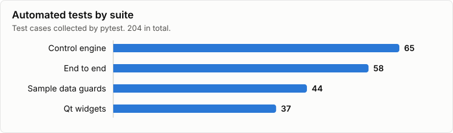
</p>
<p align="center">
  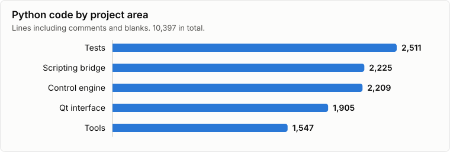
</p>

## Status and roadmap

**Works today**

- [x] Qt interface with navigation between all included transactions
- [x] COM, HTTP, and in-process bridges reading and writing the active session
- [x] Script-driven navigation through `StartTransaction`, the command field, and virtual keys
- [x] Action recording
- [x] Generated sample screens with automated guards against live-system data
- [x] Modal popups (`wnd[1]`, `wnd[2]`) for logon and password flows
- [x] Table control and ALV grid scrolling

**Coming next**

- [ ] Keyboard focus engine
- [ ] Value help (F4) and other popups
- [ ] Functional status bar messages
- [ ] Screens that react to what you enter: `XD03` does (see [`engine/reactive.py`](engine/reactive.py)); the other flows are still fixed, so SE16 always opens the sample `SFLIGHT` table

## Documentation

| Document | Description |
|---|---|
| [Architecture](docs/architecture.md) | Layer-by-layer design |
| [API Reference](docs/api_reference.md) | COM, HTTP, and Python APIs |
| [User Guide](docs/user_guide.md) | Installation and usage (French) |
| [Technical Documentation](docs/DOCUMENTATION_TECHNIQUE.md) | Data model and COM bridge (French) |

## Adding screens

The sample screens are defined in [`tools/generate_screens.py`](tools/generate_screens.py). `tools/sap_inspect.py` can also capture screens from a SAP system you are authorised to access. Captures contain system identifiers, usernames, hostnames, and business data, so **never commit a capture or a screenshot of a live system**. `tests/test_screens_sanitized.py` checks for placeholder identities, email addresses, IP addresses, and non-English text, but it can't detect every kind of sensitive value.

## License

Licensed under the [Apache License, Version 2.0](LICENSE). See [NOTICE](NOTICE) for attributions and trademark details.
